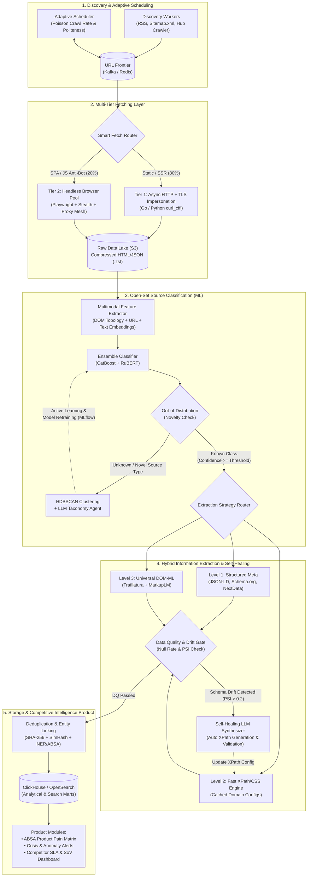

# kaspersky_test_task_intern2026
# Пайплайн сбора, классификации и анализа внешних источников (Competitive Intelligence & Media Monitoring)

Репозиторий содержит решение тестового задания для отдела конкурентной разработки . Проект включает рабочий прототип парсера с контролем качества данных (Data Quality), многомерную таксономию источников и архитектурный дизайн масштабирования системы до 10 000+ доменов.

---

## Быстрый старт (Задание 1.1 — Код и данные)

Пайплайн использует `curl_cffi` с имперсонацией TLS-отпечатка браузера Chrome (`JA3/HTTP2`) и автоматическим переключением на локальные HTML-снапшоты из `data/raw_html_snapshots/` в случае блокировки IP антибот-системами (Cloudflare / DDoS-Guard).

```bash
# 1. Установка зависимостей
python -m venv .venv
source .venv/bin/activate  # Для Windows: .venv\Scripts\activate
pip install -r requirements.txt

# 2. Запуск пайплайна извлечения данных
python -m src.main

# 3. Результат работы сохраняется в:
# - data/output/extracted_dataset.jsonl (нормализованные документы)
# - data/output/dq_summary_report.json (метрики качества данных DQ)
```

---

## Задание 1. Извлечение данных и классификация источников

### 1.1. Единый контракт данных (Unified Data Model) и извлекаемые поля

Поскольку исследуемые ссылки находятся на разных уровнях вложенности сайтов (**каталоги**, **карточки объектов**, **тематические ленты**), данные нормализуются в двухуровневую структуру:
1. **`SourceDocument` (Уровень витрины/хаба):** `doc_id` (SHA-256 от канонического URL), метаданные `OpenGraph` и `Schema.org (JSON-LD)`, агрегированные метрики страницы (`hub_metrics`) и встроенный отчет о качестве данных (`dq_report`).
2. **`ExtractedItem` (Уровень единицы контента):** `item_id`, `content_hash` (SHA-256 от заголовка и текста для идемпотентности и детекции изменений), базовые атрибуты (`title`, `text`, `author`, `published_at_raw`), метрики вовлеченности (`metrics`) и специфичные для площадки поля (`domain_attributes`).

| № | Источник | Уровень графа (`page_granularity`) | Базовые поля (`Core`) | Специфичные доменные поля (`domain_attributes` & `metrics`) | Ценность для конкурентной разведки и DS |
|---|---|---|---|---|---|
| **1** | **IRecommend**<br>`/content/sait-ozontravel-0` | `object_hub`<br>(Карточка объекта + лента отзывов) | Заголовок отзыва, сниппет/полный текст, автор, дата публикации | Структурированные списки `pros` (достоинства) и `cons` (недостатки), `star_rating` (1–5), общий рейтинг объекта, число отзывов, наличие фото/скринов | Готовая разметка для **ABSA** (Aspect-Based Sentiment Analysis) и выявления продуктовых болей клиентов конкурента |
| **2** | **LiveJournal**<br>`5koleso.livejournal.com` | `topic_feed`<br>(Хронологическая лента блога) | Заголовок поста, текст превью (до `lj-cut`), автор (`5koleso`), timestamp | Пользовательские теги (`tags`), число комментариев, социальный капитал блога, внешние ссылки на основной сайт `5koleso.ru` | Связывание кросс-постинга СМИ с блогосферой, оценка вовлеченности аудитории вокруг редакционных материалов |
| **3** | **Дзен Новости**<br>`/news/rubric/computers` | `topic_feed`<br>(Рубрикатор новостного агрегатора) | Заголовок сюжета, дайджест (аннотация), СМИ-источник, время | Размер кластера (число СМИ в сюжете), список всех СМИ сюжета, идентификатор рубрики | Оценка **веса инфоповода** (Media Impact), вычисление первоисточника вброса новости и скорости распространения (`Story Velocity`) |
| **4** | **4PDA Forum**<br>`/forum/.../showforum=320` | `catalog_index`<br>(Индексная страница раздела форума) | Название темы, подзаголовок/описание, автор темы (топикстартер), дата последнего поста | Закрепленные темы (`is_pinned`), куратор, наличие опроса, `replies_count`, `views_count`, подразделы | Выявление самых «горячих» веток обсуждения продуктов/прошивок по `reply_to_view_ratio` и скорости прироста ответов |
| **5** | **Отзовик**<br>`/money_systems/banks/` | `catalog_index`<br>(Отраслевой каталог объектов) | Название банка/продукта, ссылка на хаб отзывов (внутри: текст, автор, дата) | Средний рейтинг банка (`avg_rating`), общее число отзывов, доля рекомендующих (`recommend_pct`), наличие ответов представителя | Прямой конкурентный бенчмаркинг всей отрасли (Share of Ratings, рейтинг лояльности, SLA ответов поддержки банков) |
| **6** | **Drive2**<br>`/featured-topics/...` | `topic_feed`<br>(Тематическая подборка постов) | Заголовок записи, лид-абзац, никнейм автора, дата публикации | Привязка к объекту автомобиля (`car_brand`, `car_model`, `car_url`), пробег (`mileage`), стоимость ремонта (`cost`), лайки, комментарии | Анализ стоимости владения (TCO), частоты поломок узлов и популярности брендов запчастей в реальной эксплуатации |

---

### 1.2. Классификация источников и разрешение спорных случаев

Для задач DE/DS применена **двумерная классификация**: по **функциональному классу площадки** (определяет бизнес-логику анализа и NLP-модели) и по **топологическому типу страницы** (определяет глубину обхода краулера `crawl_depth`).

1. **Review-платформы (Сайты отзывов):** `irecommend.ru`, `otzovik.com`.
2. **Профильные форумы и вертикальные UGC-сообщества:** `4pda.to`, `drive2.ru`.
3. **Блог-платформы (Корпоративные и авторские блоги в соцмедиа):** `5koleso.livejournal.com`.
4. **Новостные СМИ-агрегаторы:** `dzen.ru/news`.

#### Разбор спорных (пограничных) кейсов:
* **Спорный кейс №1: `5koleso.livejournal.com` — Онлайн-СМИ или Блог-платформа?**
  * *Конфликт:* Контент пишется профессиональной редакцией автомобильного журнала «5 колесо», но размещен на блог-платформе ЖЖ.
  * *Решение:* Классифицировать платформу как `blog_platform` с атрибутом автора `corporate_media_blog`.
  * *Обоснование:* В медиамониторинге классификация по площадке предотвращает дублирование тиража СМИ с основным доменом `5koleso.ru` и позволяет корректно учитывать специфичные для ЖЖ метрики (рейтинг блога, ветви комментариев читателей).
* **Спорный кейс №2: `drive2.ru` — Блог, Форум или Вертикальная соцсеть?**
  * *Конфликт:* Присутствуют личные бортжурналы (блоги), сообщества (форумы) и карточки машин.
  * *Решение:* Отнести к классу **Вертикальных профильных UGC-сообществ** (в одну аналитическую группу с `4pda.to`).
  * *Обоснование:* В графе данных Drive2 центральной сущностью является не автор, а **объект эксплуатации (автомобиль)** с техническими параметрами, пробегом и расходами. Для конкурентной разведки эта структура идентична веткам обсуждения конкретных моделей устройств на 4PDA.
* **Спорный кейс №3: Разная гранулярность внутри одного класса (`irecommend.ru/content/...` vs `otzovik.com/money_systems/banks/`)**
  * *Решение:* Оба сайта имеют класс `review_platform`, но разный топологический тип узла (`object_hub` против `catalog_index`). Это задает разную маршрутизацию для краулера: на IRecommend парсер сразу собирает отзывы из пагинации объекта, а на Отзовике сначала извлекает список банков (`Entity Discovery`) и ставит их карточки в очередь обхода второго уровня.

---

## Задание 2. Масштабирование: 10, 100, 1 000, 10 000 источников

При росте числа источников в 1 000 раз главная проблема смещается с написания кода на **автоматическое удержание качества данных при постоянной смене верстки сайтов (Layout/Schema Drift)**.

| Масштаб | Стратегия извлечения (Parsing) | Инфраструктура и очереди | Контроль качества (Data Quality) |
|---|---|---|---|
| **10 сайтов** | Индивидуальные Python-парсеры (`BeautifulSoup`/`lxml`) под каждый сайт. | Один воркер / контейнер, запуск по `cron`. | Базовые проверки `assert` и валидация через Pydantic. |
| **100 сайтов** | Единое ядро парсера + **декларативные YAML-конфиги** с XPath/CSS-селекторами для каждого домена. | Очередь задач `Celery` + `Redis/RabbitMQ`, ротация прокси, пул `Playwright` для SPA. | Мониторинг доли пустых полей (`null_rate`) и алерты при падении потока документов. |
| **1 000 сайтов** | **Гибридный подход:** шаблоны под типовые CMS (`XenForo`, `vBulletin`, `IPB`, `WordPress`) + парсинг `Schema.org / JSON-LD` + универсальные экстракторы (`Trafilatura`). | Стриминговый пайплайн на `Apache Kafka`, кластер воркеров в Kubernetes, хранение сырого HTML в `S3`, аналитика в `ClickHouse`. | Автоматический расчет метрик `DQ-01..DQ-07` (полнота, валидность дат, дубли по `SimHash`) и дашборды SLA в Grafana. |
| **10 000 сайтов** | **Tiered-архитектура:**<br>• **Tier 1 (Top 1%):** кастомные адаптеры с минутным SLA.<br>• **Tier 2 (Top 10%):** автогенерация XPath-правил через LLM-агента.<br>• **Tier 3 (90% Long Tail):** универсальные DOM-ML модели (`MarkupLM`) + RSS/Sitemap. | Распределенный `URL Frontier` с динамическим расписанием (Adaptive Crawl Rate) и соблюдением `Politeness Policy` по доменам. | **Self-Healing Pipeline:** мониторинг сдвига распределений (**PSI / KS-test**) и автоматическая перегенерация сломанных селекторов через LLM. |

---

## Задание 3. Архитектура автоматизации (DE / DS) и продуктовое применение

### 3.1 и 3.2. Архитектурная схема промышленного пайплайна сбора и ML-обработки



### Ключевые механизмы автоматизации (Задание 3.2):
1. **Классификация с детекцией новых типов источников (Open-Set Recognition):**
   * Классификатор опирается на 3 группы признаков: **топологию DOM-дерева** (плотность ссылок `link_density`, глубина дерева, число изоморфных карточек списков, наличие звезд рейтинга/форм ответа), **URL-паттерны** и **семантические эмбеддинги**.
   * Если страница имеет высокую энтропию предсказания или большое расстояние Махаланобиса до центроидов существующих классов, она попадает в буфер `Novelty Buffer`.
   * Алгоритм **HDBSCAN** кластеризует неизвестные домены по их структурно-текстовым векторам. При появлении плотного кластера новых площадок (например, Q&A-витрин маркетплейсов или публичных веб-каналов мессенджеров) LLM-агент формирует описание нового класса для подтверждения аналитиком (Active Learning) и переобучения модели.
2. **Самовосстанавливающееся извлечение данных (Self-Healing Extraction):**
   * Вызывать LLM на каждый из миллионов документов экономически нецелесообразно. Поэтому LLM используется как **генератор детерминированных правил (Parser Synthesizer)**: при добавлении нового домена или при срабатывании алерта **PSI-дрейфа** (когда сайт сменил верстку и `completeness_score` упал) LLM-агент по 3 сэмплам HTML синтезирует новые XPath-селекторы, автоматически тестирует их на 10 страницах и обновляет конфиг в базе.

---

### 3.3. Продуктовые возможности для медиамониторинга и конкурентной разведки

На базе нормализованных данных и специфичных доменных атрибутов строятся 6 продуктовых функций:

1. **Матрица продуктовых уязвимостей конкурентов (ABSA Pain Matrix):** использование готовых полей `pros`/`cons` с отзовиков и постов с форумов для автоматического выявления слабых мест в продуктах конкурентов (например, рост жалоб на конкретную функцию банковского приложения или частый баг после обновления прошивки на 4PDA).
2. **Инженерный и эксплуатационный бенчмаркинг (R&D & TCO Intelligence):** анализ структурированных записей бортжурналов (Drive2) по связке `модель -> пробег -> узел поломки -> стоимость ремонта` для оценки реальной надежности и стоимости владения продуктами конкурентов.
3. **Оценка веса инфоповодов и детекция PR-атак (Story Velocity & Media Impact):** использование размера новостных сюжетов в агрегаторах (Дзен Новости) для разделения мелких публикаций и крупных федеральных инфоповодов, а также отслеживание конверсии «новость в СМИ $\rightarrow$ всплеск обсуждений на форумах и в отзовиках».
4. **Бенчмаркинг клиентского сервиса и ORM конкурентов (Support SLA Analytics):** отслеживание доли ответов официальных представителей брендов на негативные отзывы (Отзовик, IRecommend), расчет скорости реакции (`response_time`) и процента решенных проблем.
5. **Раннее предупреждение о сбоях и репутационных кризисах (Real-Time Anomaly Detection):** мониторинг аномальных скачков скорости постинга в профильных ветках (`reply_velocity`) и резкого падения средней оценки для мгновенного оповещения продуктовых и PR-команд.
6. **Детекция координированных кампаний и накруток (Astroturfing & Bot Detection):** графовый анализ авторов (репутация, дата регистрации, синхронность публикаций и близость текстов по `SimHash`/эмбеддингам) для фильтрации заказного позитива конкурентов и черного PR.
